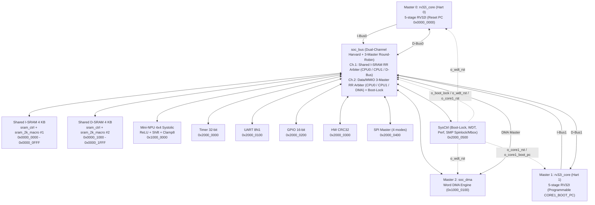

# Đặc tả Kỹ thuật SoC & Kế hoạch Verification UVM (`soc_top`)

> **Dự án:** Dual-Core RV32I SoC — RTL Design & UVM Verification  
> **Top Module:** [`rtl/soc_top.v`](../rtl/soc_top.v) · **Filelist:** [`rtl/filelist_soc.f`](../rtl/filelist_soc.f) · **SRAM Model:** [`sim/sram_2k_macro.v`](../sim/sram_2k_macro.v)  
> **Mục đích tài liệu:** Bàn giao đầy đủ kiến trúc phần cứng, bản đồ thanh ghi, giao thức và khung **UVM Verification Plan + Functional Coverage** để triển khai bộ testbench UVM.

---

## 1. Tổng quan Kiến trúc Hệ thống



---

## 2. Giao tiếp Top-Level (`soc_top`)

Parameter: `PR_UART_CLKS_PER_BIT` (mặc định `868` cho 115200 baud @ 100 MHz; gợi ý `16` khi chạy UVM để tăng tốc mô phỏng).

| Cổng | Hướng | Độ rộng | Mô tả |
|---|---|---:|---|
| `i_clk` | Input | 1 | Xung nhịp hệ thống (100 MHz) |
| `i_resetn` | Input | 1 | Reset bất đồng bộ, tích cực thấp |
| `i_uart_rxd` | Input | 1 | Đường nhận serial UART (idle = `1`) |
| `o_uart_txd` | Output | 1 | Đường phát serial UART (idle = `1`) |
| `i_gpio_in` | Input | 16 | Ngõ vào song song GPIO |
| `o_gpio_out` | Output | 16 | Thanh ghi ngõ ra GPIO (reset = `0`) |
| `o_gpio_oe` | Output | 16 | Output Enable GPIO (reset = `0`) |
| `o_spi_sclk` | Output | 1 | Xung nhịp SPI Master |
| `o_spi_mosi` | Output | 1 | Dữ liệu phát Master -> Slave |
| `i_spi_miso` | Input | 1 | Dữ liệu thu Slave -> Master |
| `o_spi_cs_n` | Output | 1 | Chip Select tích cực thấp (reset = `1`) |
| `o_wdt_rst` | Output | 1 | Xung 1 chu kỳ báo Watchdog vừa kích hoạt reset CPU |

---

## 3. Bản đồ Không gian Địa chỉ (Memory Map)

| Địa chỉ Byte | Kích thước | Slave | Ghi chú |
|---|---:|---|---|
| `0x0000_0000 – 0x0000_0FFF` | 4 KB | `u_isram_ctrl` (I-SRAM) | Reset vector `0x0000_0000`. Vùng `0x0000_0000–0x0000_01FF` (512B đầu) bị khóa ghi khi `BOOT_LOCK = 1`. |
| `0x0000_1000 – 0x0000_1FFF` | 4 KB | `u_dsram_ctrl` (D-SRAM) | RAM dữ liệu cho CPU & DMA; đọc/ghi song song với I-Fetch của CPU. |
| `0x1000_0000 – 0x1000_00FF` | 256 B | `u_accel` (Mini-NPU) | Mảng Systolic 4×4 INT8 + Post-Proc (ReLU, Shift, Clamp8). |
| `0x1000_0100 – 0x1000_01FF` | 256 B | `u_dma` (DMA Engine) | DMA copy word 32-bit; DMA tự truy cập vùng `0x1000_01xx` bị chặn an toàn. |
| `0x2000_0000 – 0x2000_00FF` | 256 B | `u_timer` | Timer đếm lùi 32-bit (one-shot / periodic). |
| `0x2000_0100 – 0x2000_01FF` | 256 B | `u_uart` | UART 8-N-1 TX/RX. |
| `0x2000_0200 – 0x2000_02FF` | 256 B | `u_gpio` | GPIO 16-bit (`DATA_IN`, `DATA_OUT`, `OE`). |
| `0x2000_0300 – 0x2000_03FF` | 256 B | `u_crc` | HW CRC-32 (IEEE 802.3). |
| `0x2000_0400 – 0x2000_04FF` | 256 B | `u_spi` | SPI Master 8-bit full-duplex, 4 modes. |
| `0x2000_0500 – 0x2000_05FF` | 256 B | `u_sysctrl` | `BOOT_LOCK`, Watchdog Timer, `MCYCLE`/`MINSTRET`, `SOC_ID`, Dual-Core SMP (`0x24–0x3C`). |

> **Lưu ý giao thức Bus cho Team UVM:**
> - Chỉ `I-SRAM` và `D-SRAM` hỗ trợ ghi lẻ byte/halfword (`sb`/`sh` qua `i_be[3:0]`). Toàn bộ các slave MMIO (`0x1000_xxxx`, `0x2000_xxxx`) chỉ nhận truy cập **word 32-bit căn chẵn (`lw`/`sw`)** và không có cổng `i_be`.
> - `GPIO.DATA_IN` (`0x2000_0200`) đi qua bộ đồng bộ 2-FF nội bộ (`reg_gpio_in_sync1/2`), có độ trễ 2 chu kỳ `i_clk` từ chân `i_gpio_in` vào thanh ghi đọc.
> - Khi Watchdog hết hạn (`o_wdt_rst = 1`), `u_dma` hủy burst đang chạy (`i_soft_rst`) và `u_bus` (nhận `o_wdt_rst` cho CPU0/DMA và `o_core1_rst` cho CPU1) chặn xung `ready` mồ côi trả về master bị reset trong khi vẫn để slave nhiều chu kỳ hoàn tất sạch mà không treo bus.

---

## 4. Chi tiết Thanh ghi & Giao thức Từng Khối

### 4.1 Mini-NPU Accelerator (`0x1000_0000`, [`rtl/accel/accel_wrapper.v`](../rtl/accel/accel_wrapper.v))

Tính tích ma trận có dấu $C_{4\times 4} = A_{4\times 4} \times B_{4\times 4}$ với phần tử $A, B \in [-128, 127]$ (`int8`), tích lũy 20-bit có dấu (`int20`).

| Offset | Tên | Quyền | Mô tả Bit-field |
|---|---|---|---|
| `0x00` | `CTRL` | W | `[0]` `start` (W1P: xóa accumulator rồi chạy 10 chu kỳ), `[1]` `clear` (W1P) |
| `0x04` | `STATUS` | R | `[0]` `busy`, `[1]` `done` (sticky — **tự xóa khi đọc `STATUS`** hoặc khi `start`) |
| `0x08` | `A_IDX` | RW | `[3:0]` chỉ số ma trận A (`row*4 + col`, `0..15`) |
| `0x0C` | `A_DATA` | RW | `[7:0]` phần tử `A[A_IDX]` (khi ghi, tự tăng `A_IDX += 1`) |
| `0x10` | `B_IDX` | RW | `[3:0]` chỉ số ma trận B (`row*4 + col`, `0..15`) |
| `0x14` | `B_DATA` | RW | `[7:0]` phần tử `B[B_IDX]` (khi ghi, tự tăng `B_IDX += 1`) |
| `0x18` | `R_IDX` | RW | `[1:0]` `row` ($i$), `[3:2]` `col` ($j$) của kết quả `C[i][j]` |
| `0x1C` | `R_DATA` | R | `[31:0]` giá trị thô 20-bit sign-extended của `C[row][col]` |
| `0x20` | `POST_CFG` | RW | `[0]` `relu_en`, `[4:1]` `shift` ($0..15$), `[5]` `clamp8_en` (`[-128, 127]`) |
| `0x24` | `R_POST` | R | `[31:0]` kết quả sau hậu xử lý: $\text{Clamp8}(\text{ReLU}(C[i][j]) \ggg \text{shift})$ |
| `0x28` | `A_PACK` | W | Ghi 4 phần tử 1 hàng A: `{A[r][3], A[r][2], A[r][1], A[r][0]}`, tự tăng `A_IDX += 4` |
| `0x2C` | `B_PACK` | W | Ghi 4 phần tử 1 hàng B: `{B[r][3], B[r][2], B[r][1], B[r][0]}`, tự tăng `B_IDX += 4` |

### 4.2 DMA Controller (`0x1000_0100`, [`rtl/dma/soc_dma.v`](../rtl/dma/soc_dma.v))

| Offset | Tên | Quyền | Mô tả |
|---|---|---|---|
| `0x00` | `CTRL` | RW | `[0]` `start` (W1P), `[1]` `src_inc` (rst=1), `[2]` `dst_inc` (rst=1) |
| `0x04` | `STATUS` | R | `[0]` `busy`, `[1]` `done` (sticky — tự xóa khi đọc `STATUS` hoặc `start`) |
| `0x08` | `SRC_ADDR` | RW | `[31:0]` địa chỉ nguồn (ép chẵn word `[1:0]=00`) |
| `0x0C` | `DST_ADDR` | RW | `[31:0]` địa chỉ đích (ép chẵn word `[1:0]=00`) |
| `0x10` | `LEN_WORDS` | RW | `[9:0]` số word 32-bit cần truyền (`LEN_WORDS = 0` trả `done = 1` ngay) |

> **Mẹo dùng DMA + Mini-NPU:** Đặt `SRC_ADDR = 0x0000_1100`, `DST_ADDR = 0x1000_0028` (`A_PACK`), `LEN_WORDS = 4`, ghi `CTRL = 0x3` (`start=1, src_inc=1, dst_inc=0`) để nạp trọn ma trận $4\times 4$ chỉ trong 1 lệnh DMA.

### 4.3 Timer (`0x2000_0000`), UART (`0x2000_0100`), GPIO (`0x2000_0200`)

| Khối | Offset | Tên | Quyền | Mô tả |
|---|---|---|---|---|
| **Timer** | `0x00` | `CTRL` | RW | `[0]` `en` (tự về 0 khi hết one-shot), `[1]` `periodic` |
| | `0x04` | `LOAD` | RW | Giá trị nạp lại (ghi đồng thời cập nhật `COUNT`) |
| | `0x08` | `COUNT` | R | Giá trị bộ đếm lùi hiện tại |
| **UART** | `0x00` | `TXDATA` | W | `[7:0]` byte phát (khung 8-N-1, LSB first) |
| | `0x04` | `RXDATA` | R | `[7:0]` byte thu mới nhất (đọc xóa `rx_valid`) |
| | `0x08` | `STATUS` | R | `[0]` `tx_busy`, `[1]` `rx_valid` |
| | `0x0C` | `CTRL` | RW | `[0]` `en` |
| **GPIO** | `0x00` | `DATA_IN` | R | `[15:0]` đọc `i_gpio_in` qua bộ đồng bộ 2-FF (độ trễ 2 chu kỳ) |
| | `0x04` | `DATA_OUT` | RW | `[15:0]` xuất ra `o_gpio_out` |
| | `0x08` | `OE` | RW | `[15:0]` xuất ra `o_gpio_oe` |

### 4.4 HW CRC-32 (`0x2000_0300`, [`rtl/periph/soc_crc32.v`](../rtl/periph/soc_crc32.v))

Chuẩn **IEEE 802.3** (đa thức phản xạ `0xEDB8_8320`, init `0xFFFF_FFFF`, XOR cuối `0xFFFF_FFFF`, khớp `zlib.crc32()`).

| Offset | Tên | Quyền | Mô tả |
|---|---|---|---|
| `0x00` | `CTRL` | W | `[0]` `INIT` (W1P đặt thanh ghi tích lũy về `0xFFFF_FFFF`) |
| `0x04` | `DATA_BYTE` | W | `[7:0]` nạp 1 byte (1 chu kỳ) |
| `0x08` | `DATA_WORD` | W | `[31:0]` nạp 4 byte thứ tự little-endian (`[7:0]` trước `[31:24]`, giữ `o_ready=0` trong 3 chu kỳ, xong ở chu kỳ 4) |
| `0x0C` | `RESULT` | R | `reg_crc ^ 0xFFFF_FFFF` (`"123456789"` $\rightarrow$ `0xCBF4_3926`) |
| `0x10` | `RAW` | R | Giá trị tích lũy chưa đảo bit |

### 4.5 SPI Master (`0x2000_0400`, [`rtl/periph/soc_spi.v`](../rtl/periph/soc_spi.v))

| Offset | Tên | Quyền | Mô tả |
|---|---|---|---|
| `0x00` | `TXDATA` | W | `[7:0]` bắt đầu truyền 8-bit (MSB first) khi `en=1 && !busy` |
| `0x04` | `RXDATA` | R | `[7:0]` byte thu được (đọc xóa `rx_valid`) |
| `0x08` | `STATUS` | R | `[0]` `busy`, `[1]` `rx_valid` |
| `0x0C` | `CTRL` | RW | `[0]` `en`, `[1]` `cpol`, `[2]` `cpha`, `[3]` `cs_auto` (rst=1), `[4]` `cs_manual` (rst=1), `[15:8]` `clkdiv` (nửa chu kỳ - 1, rst=3) |

### 4.6 SysCtrl: Boot-Lock, Watchdog, Perf & Dual-Core SMP (`0x2000_0500`, [`rtl/periph/soc_sysctrl.v`](../rtl/periph/soc_sysctrl.v))

| Offset | Tên | Quyền | Mô tả |
|---|---|---|---|
| `0x00` | `BOOT_LOCK` | RW1S/R | `[0]` `lock` (ghi 1 để khóa ghi `0x0000_0000–0x0000_01FF`, chỉ mở khi hard reset `i_resetn`), `[1]` `boot_viol` (RO sticky) |
| `0x04` | `WDT_CTRL` | RW/W1C | `[0]` `en`, `[1]` `expired` (RO/W1C: ghi 1 xóa cờ sau reboot) |
| `0x08` | `WDT_LOAD` | RW | Giá trị nạp bộ đếm lùi Watchdog (rst=`0xFFFF_FFFF`) |
| `0x0C` | `WDT_KICK` | W | Ghi `0x5A5A_A5A5` để reload `WDT_CNT <= WDT_LOAD` |
| `0x10` | `WDT_CNT` | R | Giá trị đếm hiện tại của WDT |
| `0x14` | `PERF_CTRL` | RW | `[0]` `en` (rst=1), `[1]` `clear` (W1P xóa `MCYCLE`, `MINSTRET_LO` & `MINSTRET1_LO`) |
| `0x18` | `MCYCLE_LO` | R | Số chu kỳ `i_clk` đếm được |
| `0x1C` | `MINSTRET_LO` | R | Số lệnh RV32I của **Core 0** hoàn tất ở WB |
| `0x20` | `SOC_ID` | R | `0x564D_3102` |
| `0x24` | `HART_ID` | R | `[1:0]` ID của master đang truy cập (`0` = CPU0, `1` = CPU1, `2` = DMA) |
| `0x28` | `CORE1_CTRL` | RW/RO | `[0]` `core1_en` (rst=`0`), `[1]` `core1_rst_pulse` (W1P), `[2]` `spinlock_locked`, `[4:3]` `spinlock_owner`, `[5]` `mbox_0to1_valid`, `[6]` `mbox_1to0_valid` |
| `0x2C` | `CORE1_BOOT_PC` | RW | Địa chỉ entry của **Core 1** khi thoát soft-reset (rst=`0x0000_0000`) |
| `0x30` | `SPINLOCK` | R/W | **Đọc**: Test-and-Set nguyên tử (`0` = vừa chiếm khóa, `1` = đang bận). **Ghi `0`**: nhả khóa |
| `0x34` | `MBOX_0TO1` | RW | Mailbox Core 0 $\rightarrow$ Core 1 (ghi dựng `mbox_0to1_valid=1`; Core 1 đọc tự xóa valid) |
| `0x38` | `MBOX_1TO0` | RW | Mailbox Core 1 $\rightarrow$ Core 0 (ghi dựng `mbox_1to0_valid=1`; Core 0 đọc tự xóa valid) |
| `0x3C` | `MINSTRET1_LO` | R | Số lệnh RV32I của **Core 1** hoàn tất ở WB |

### 4.7 Giao thức UART Secure Bootloader (`firmware/bootloader/bootloader.s`)

1. Host gửi Sync `0x7F` $\rightarrow$ Bootloader xóa CRC32 và trả `'y'` (`0x79`).
2. Host gửi 1 byte `N` ($1 \le N \le 255$, số word 32-bit của ứng dụng).
3. Host gửi lần lượt `N` word (4 byte/word, little-endian); sau mỗi word Bootloader ghi vào `0x0000_0200 + 4*k`, đẩy vào `CRC32.DATA_WORD` và trả ACK `0x06`.
4. Host gửi 4 byte `expected_crc` (little-endian).
5. Bootloader so sánh `expected_crc` với `CRC32.RESULT`:
   - **Sai:** trả **NAK `0x15`** và chờ nạp lại, không nhảy vào App.
   - **Đúng:** trả **EOT `0x04`**, khóa `BOOT_LOCK = 1` và nhảy tới `0x0000_0200`.

---

## 5. Kế hoạch Triển khai UVM Testbench & Functional Coverage (Bàn giao Team Verification)

### 5.1 Kiến trúc UVM Environment đề xuất

| Thành phần UVM | Vai trò |
|---|---|
| `uart_agent` (Active) | Driver phát frame UART (Sync, Length, Firmware words, CRC đúng/sai) + Monitor thu phản hồi `'y'`, `ACK`, `NAK`, `EOT`, chuỗi từ App |
| `gpio_agent` (Active + Passive) | Driver kích ngõ `i_gpio_in[15:0]` + Monitor bắt `o_gpio_out` / `o_gpio_oe` |
| `spi_agent` (Active/Responder) | Slave Responder + Monitor hỗ trợ cả 4 mode `(CPOL, CPHA)` và kiểm tra framing `o_spi_cs_n`, `o_spi_sclk`, `o_spi_mosi` |
| `sys_mon` (Passive) | Theo dõi `o_wdt_rst` và giao dịch nội bộ trên `u_bus` (qua interface tap) phục vụ scoreboard & cross coverage |
| `soc_scoreboard` | Mô hình tham chiếu Python/SV cho: CRC-32 IEEE 802.3, nhân ma trận $4\times 4$ + ReLU/Shift/Clamp8, hành vi SPI/GPIO/UART, Boot-Lock |
| `soc_coverage` | Subscriber thu thập toàn bộ Covergroup bên dưới để đóng 100% Functional Coverage |

### 5.2 Ma trận Covergroups cần đạt 100%

| Covergroup | Coverpoints & Bins bắt buộc | Cross Coverage gợi ý |
|---|---|---|
| `cg_uart_boot` | • Sync hợp lệ (`0x7F`) vs byte nhiễu (`!= 0x7F`)<br>• Độ dài `N`: nhỏ (`1..4`), vừa, lớn<br>• CRC status: `PASS` (EOT `0x04`) vs `CORRUPT_1BIT` / `CORRUPT_MULTI` (NAK `0x15`)<br>• Timeout Bootloader khi không có Sync | `N_bins × crc_status` |
| `cg_rv32i_ hazards` | • Đủ nhóm opcode: ALU R/I, Shift (`sll/srl/sra`), Load/Store (`b/h/w`), Branch (`beq/bne/blt/bge/bltu/bgeu`), `jal/jalr/lui/auipc`<br>• Forwarding paths: EX-MEM, MEM-WB, Regfile WB-to-ID<br>• Load-use stall, Branch taken vs not-taken, `JAL` ngay sau `SW/LW` | `opcode_group × hazard_type` |
| `cg_sram_rmw` | • Bank: `I-SRAM` vs `D-SRAM`<br>• Access type: `READ`, `WORD_WR`, `HALF_WR` (`addr[1]=0/1`), `BYTE_WR` (`addr[1:0]=0..3`)<br>• Tranh chấp đồng thời CPU I-Fetch + D-Bus trên `I-SRAM` vs chạy song song trên `D-SRAM` | `bank × access_type × contention` |
| `cg_npu_post` | • Giá trị `int8`: biên `-128`, âm, `0`, dương, biên `+127`<br>• `relu_en`: `{0, 1}`<br>• `shift`: `0`, vừa (`1..4`), lớn<br>• `clamp8_en`: `{0, 1}` (phủ trường hợp overflow `>127` và underflow `<-128`)<br>• Nạp bằng `A_DATA/B_DATA` vs DMA `A_PACK/B_PACK` | `relu_en × clamp8_en × sign_of_acc` |
| `cg_dma_bus` | • `src_inc × dst_inc` (`00, 01, 10, 11`)<br>• `len_words`: `0`, `1`, `4`, `>=16`<br>• Arbiter collision: CPU D-Bus tranh chấp với DMA đang burst | `inc_mode × len_bin × cpu_contention` |
| `cg_spi_master` | • 4 modes `(cpol, cpha) ∈ {00, 01, 10, 11}`<br>• `cs_auto`: `{0, 1}`<br>• `clkdiv`: `0`, `1`, `>=4`<br>• Data pattern: `0x00, 0xFF, 0xA5, 0x5A` | `mode × cs_auto × data_pattern` |
| `cg_security_wdt` | • `BOOT_LOCK`: ghi vùng Boot khi `lock=0` (cho phép) vs `lock=1` (bị chặn, `boot_viol=1`)<br>• `WDT`: kick đúng hạn (`0x5A5AA5A5`), kick sai key, hết hạn phát `o_wdt_rst` + park `core1_en=0` + kiểm tra `wdt_expired` W1C | `boot_lock_state × write_region` |
| `cg_dualcore_smp` | • `HART_ID` đọc từ CPU0 (`0`), CPU1 (`1`), và DMA (`2`)<br>• `CORE1_CTRL`: `core1_en = 0/1`, `core1_rst_pulse = 1`, thay đổi `CORE1_BOOT_PC`<br>• `SPINLOCK`: chiếm thành công (`0`), xung đột bận (`1`), nhả khóa (`W=0`) từ cả CPU0 & CPU1<br>• `MBOX_0TO1` / `MBOX_1TO0`: ghi dựng valid, Core đích đọc tự xóa valid vs Core nguồn đọc không xóa valid<br>• Round-Robin công bằng: CPU0 + CPU1 cùng fetch I-SRAM; CPU0 + CPU1 + DMA cùng truy cập D-Bus | `master_id × rr_winner × spinlock_state` |

### 5.3 SVA Assertions gợi ý gắn qua `bind`
1. **Boot-Lock Immutability:** Khi `o_boot_lock == 1`, mọi giao dịch ghi vào `0x0000_0000..0x0000_01FF` không được bật `o_isram_we` trên `u_isram_ctrl` và phải dựng cờ `o_boot_lock_viol`.
2. **One-Cycle Watchdog Pulse:** `o_wdt_rst` chỉ lên `1` đúng 1 chu kỳ xung nhịp khi `reg_wdt_en && reg_wdt_cnt == 0`, đồng thời đưa `core1_en` về `0`.
3. **Handshake Stability:** Khi `o_dmem_req` hoặc `o_dma_req` lên `1`, địa chỉ/we/be/wdata phải giữ ổn định cho tới khi `ready` lên `1` — ngoại trừ khi `i_soft_rst == 1` (`o_wdt_rst` hoặc `o_core1_rst`), khi đó `o_dmem_req`/`o_dma_req` được phép hạ sớm và `u_bus` sẽ chặn `ready` mồ côi (trên kênh I-Fetch `o_imem_req`, `o_imem_addr` cũng được phép chuyển sang đích nhảy khi `reg_discard == 1` lúc đang chờ bus, và core tự hủy word trả về cũ).
4. **Core 1 Reset Isolation:** Khi `core1_en == 0` (hoặc `w_core1_rst == 1`), `u_cpu1` không được phát `o_imem_req` hay `o_dmem_req` lên `u_bus`.
5. **Round-Robin Zero Starvation:** Nếu `i_dmem0_req`, `i_dmem1_req`, và `i_dma_req` cùng giữ ở `1`, mọi master đều phải được cấp bus trong tối đa 3 lượt phục vụ Data/MMIO liên tiếp.

---

## 6. Lệnh kiểm tra nhanh (Lint & Simulation)

```bash
# 1. Verilator lint toàn bộ RTL (0 errors, 0 warnings)
./lint.sh

# 2. Biên dịch lại firmware (nếu chỉnh sửa file .s)
python3 scripts/rv32i_asm.py firmware/bootloader/bootloader.s firmware/bootloader/bootloader.hex 0x00000000
python3 scripts/rv32i_asm.py firmware/apps/app_update.s firmware/apps/app_update.hex 0x00000200
python3 scripts/rv32i_asm.py firmware/tests/soc_full_test.s firmware/tests/soc_full_test.hex 0x00000000

# 3. Biên dịch & chạy mô phỏng RTL bằng simulator hỗ trợ Verilog-2001/SystemVerilog (Questa / VCS / Xcelium / ...)
#    Danh sách file DUT: -f rtl/filelist_soc.f sim/sram_2k_macro.v
#    Testbench self-checking:
#      - sim/tb_soc_full.v       (chạy firmware/tests/soc_full_test.hex — gồm TEST 5B Dual-Core SMP)
#      - sim/tb_soc_bootloader.v (chạy firmware/bootloader/bootloader.hex + UART CRC32 + BOOT_LOCK)
```
